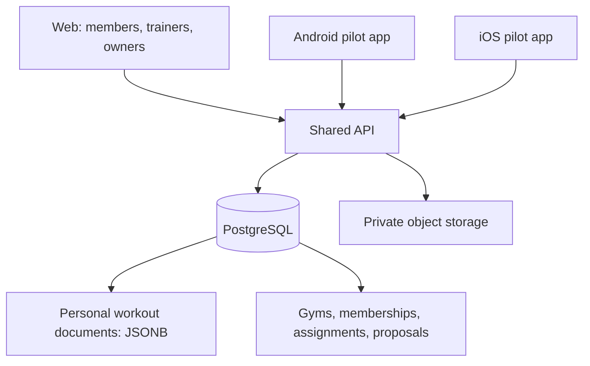

# Gym Pilot Design: Shared Platform with Upstream Compatibility

Date: 2026-10-25

Status: Architecture, workflows, permissions, mobile onboarding, and upstream-update process approved in the planning conversation. Implementation is not started by this document.

Repository baseline: `7a3ace53` on the fork's `main`. The configured `origin` is `guptaakashgupta/openGym`; the original project is `DuarteSantos8/openGym`. Only `origin` was configured during inspection. The baseline is a local observation, not a claim that it is the latest upstream commit.

## 1. Objective and Pilot Scope

Launch a paid service for an independent Indian gym using one shared web application, one Android application, and one iOS application. New gyms become organisation records, not new servers, app packages, or deployments.

Initial cohort: one paying gym with approximately 20–30 adult members, plus a second test organisation for isolation checks. Owners and trainers can administer through the web; members receive Android and iOS pilot builds. Public store releases are not a prerequisite for the pilot.

Approved constraints:

- One active gym membership per member during the pilot; preserve historical memberships and allow future expansion of the model.
- Trainers access only currently assigned members and eligible workouts recorded during the current membership.
- Trainers send versioned plan proposals. Members explicitly accept or decline them, including later updates.
- Earlier workout history, body measurements, progress photos, and private settings remain private.
- Personal history stays with the member after gym membership ends.
- Preserve upstream's workout document and sync semantics; add PostgreSQL persistence and separate gym-management modules.
- Reuse browser passkey/password authentication and native device pairing for pilot onboarding.
- Keep billing manual and assess upstream updates before deploying them.

Excluded: simultaneous gym memberships for a member, automated membership billing, gym attendance, messaging, AI coaching, trainer access to private measurements/photos, and separate branded applications per gym. Verified invitation deep links are a later improvement.

## 2. Architecture Decision

Use a modular fork. Preserve React/Capacitor, the workout engine, routine editor, document shape, and revision/conflict behaviour. Add gym modules at documented integration points for authentication context, API dispatch, frontend routes, navigation, and proposal acceptance.

Alternatives considered:

| Approach | Benefit | Reason not selected |
| --- | --- | --- |
| Separate gym-management service | Fewer gym-specific changes inside the upstream backend | Additional identity, permissions, and plan-delivery coordination across services during the pilot |
| Comprehensive relational/workflow rewrite | Full control over every domain object | Large divergence from upstream workout and mobile-sync development |

The selected approach still requires substantial changes to `api/server.js`: authentication, account storage, state persistence, and admin handling are currently coupled. The repository has no existing plugin boundary. Extract interfaces explicitly; do not hide a database behind filesystem monkeypatches or promise conflict-free upstream merges.

The initial product can run one API instance with a managed PostgreSQL database. Shared hosting already serves multiple gyms. Adding API replicas requires shared transient authentication state, coherent account reads, and coordination of background jobs; PostgreSQL alone does not make existing process-local behaviour horizontally safe.

## 3. Storage and Ownership

Proposed storage boundaries:

| Record | Responsibility |
| --- | --- |
| Users and authentication records | Personal identity, credentials, session revocation and device authorisation |
| Gyms | Name, logo reference, operational status and manually managed pilot subscription |
| Gym memberships | User, gym, role(s), start/end, status; one active member gym enforced transactionally |
| Trainer assignments | Gym, member membership, trainer membership, active interval |
| Member state documents | User-owned JSONB preserving upstream fields, revision and write ancestry |
| Plan proposals and acceptances | Immutable version, sender, recipient membership, proposal payload, decision and stable imported routine identifiers |
| Workout visibility records | Server-controlled association of eligible workout identifiers with membership context |
| Upload records and audit events | User ownership, object references, authorised access and management-event history |

Gym membership and authority are not fields trusted from a client-supplied workout document. Database constraints supplement API checks. A gym owner may also coach through an explicit trainer assignment; ownership alone is not access to private training data.

Introduce explicit asynchronous storage interfaces for identity and member state. Implement database transactions for revision compare-and-write, account/credential changes, membership transitions, and acceptance. Keep upstream JSON metadata such as `_rev`, `_wid`, ancestry, reset markers, and sync stamps intact. Preserve the existing conflict response contract and stripping of device-local active workouts.

Keep the file-backed upstream mode testable during extraction. Product deployment uses PostgreSQL as the authority, without a second writable JSON copy. Inventory every filesystem reader, including reminders, admin routes, exports, uploads, and optional coach/MCP consumers. Do not claim these work with PostgreSQL until adapted or explicitly unavailable in product mode.

Provide a repeatable migration from existing JSON storage, with validation and a cutover/recovery procedure. Existing imported documents begin private: migration must never classify all previous workouts as gym-visible.

## 4. Workflows

### Platform operator

Create the organisation, invite its owner, configure identity, and record the agreed pilot subscription. Handle invoices manually. Platform operation is separate from the upstream general administrator screen; any exceptional support access needs deliberate authorisation and an audit trail.

### Gym owner

Invite trainers and members, assign members to trainers, and end access. Invitations have a specific organisation and intended role, expire, and are consumed safely. Owner actions are scoped to their gym. Removing an assignment or membership invalidates subsequent staff access.

### Trainer

Use the existing routine editor to prepare a plan, then send a versioned proposal to assigned members. See pending/accepted/declined status and a restricted progress view. No general write access to a member's document and no direct overwrite of their history.

### Member

Authenticate, accept a gym invitation, review and accept or decline a proposal, then train using existing workout flows. Initial acceptance adds routines. Updates explicitly identify which previously accepted routines will change; never silently replace unrelated member-created routines or completed workouts. A member retains export access and their personal history after leaving.

## 5. Permissions and Privacy Boundaries

All requests validate server-side identity, current membership, role, assignment, resource ownership, and organisation consistency. A client-provided gym identifier selects a context; it does not grant access.

| Action | Authority |
| --- | --- |
| Read/edit personal workout document | Its member owner |
| Invite and manage gym membership/assignments | Owner of that gym |
| Propose plans and read permitted progress | Currently assigned trainer |
| Accept a proposal | Its receiving member, while the proposal is still eligible |
| Read private measurements/photos/settings | The member |

Do not reuse upstream's broad `admin` flag as a gym role. Audit and gate every existing admin, account-recovery, share, media, and data endpoint so legacy paths cannot bypass the new model. Gym owners cannot call platform-wide account administration.

Trainer endpoints return allowlisted projections, never the full personal document. Progress derives only from visible workouts, not lifetime PRs or precomputed statistics that include private history. Free-form fields and user-uploaded media are excluded from projections unless separately reviewed and explicitly included.

Visibility is explicit and fail-closed. Workouts created during a membership carry membership context; the server maintains validated visibility records. A timestamp filter alone is insufficient. Historical imports, restored backups, upstream clients lacking the new context, and ambiguous provenance remain private by default. Details of offline membership provenance must be validated in implementation before enabling trainer reads.

Reassignment revokes the old trainer's access. Ending membership revokes staff access to that membership's workouts; joining another gym does not reclassify them. Staff views require connectivity in the pilot. Clear cached staff views when revocation is learned, and avoid durable offline storage of staff projections. Previously viewed information or screenshots cannot be recalled.

## 6. Acceptance, Offline Sync, and Errors

Each proposal version and acceptance has a stable identity. Acceptance commits the decision, member-state revision, and imported routine mapping atomically. Retries return the original result. Never mark a proposal accepted only on the device or regenerate routine identifiers on a retry.

The client flushes or reconciles pending member changes before acceptance. The server compares the expected revision and revalidates membership/assignment. A conflict returns current state for refresh/merge and retry, without silently overwriting newer data. Completed history remains unchanged. Proposal acceptance is online-only for the pilot.

Member logging continues offline using upstream persistence and merge behaviour. Personal state remains keyed by account/server; gym context is separate. An offline workout from a previous membership can sync into personal history after departure, but cannot become visible to a new gym. Pending proposals must be revalidated on reconnect.

Expired login, connectivity loss, stale proposal, revoked access, and conflicting edits produce distinguishable UI states. Failed acceptance retains the proposal and local workout data for a safe retry. Database or object-storage outages must not acknowledge writes that were not persisted. Restored database revisions must preserve upstream ancestry/recovery behaviour.

## 7. Mobile and Web Delivery

Keep one product app per native platform and one shared React interface. Gym names/logos are runtime organisation configuration, not separate builds.

Browser onboarding reuses upstream passkey/password support and then consumes the gym invitation. Native pilot builds have the service URL configured: the member signs in in their phone browser, generates a short-lived pairing code, and enters it in the app. Preserve the existing device token lifecycle and secure-storage behaviour. Do not invent an incompatible second identity system for mobile.

Use product-specific app identifiers, branding, signing, and distribution credentials. Inventory identifiers in native projects, entitlements, extensions, notification configuration, and build workflows; changing `capacitor.config.json` alone is insufficient. Verified deep links and reduced-step onboarding are deferred.

Exercise physical Android and iOS devices for pairing, account switching, offline logging, proposal acceptance, revocation, and update installation. Pilot distribution depends on the operator's developer accounts and devices; no public-store approval date is promised.

## 8. Upstream Maintenance and Releases

Track the original repository through an `upstream` remote. Keep the fork's product development branch distinct from the remote-tracking `upstream/main`. Never rewrite upstream history or automatically deploy an upstream tip.

For an update: fetch, record the candidate SHA, merge into a dedicated integration branch based on the product branch, resolve conflicts deliberately, run upstream and product checks, rehearse mobile compatibility, review the diff, and release a pinned build. Review weekly during the pilot; assess relevant security fixes promptly.

Maintain a customisation map with every modified upstream integration point, its purpose, and the tests that protect it. Group gym logic in new modules and use small focused commits for changes to upstream files. Avoid mass formatting, renaming upstream modules without a requirement, and copying the workout engine into a second implementation.

Preserve upstream tests and add product tests. CI must run on product and integration branches and include new module paths; the current workflow's push branches and path filters do not cover arbitrary new product locations. Audit inherited release, mirror, signing, and deployment workflows before enabling them for the fork so they do not publish to upstream destinations.

Every release records product SHA, upstream SHA, schema migration version, supported pilot builds, and recovery instructions. Backend changes remain compatible with distributed pilot clients. A database migration needs its own recovery plan; application rollback alone may not suffice. Rehearse one actual upstream integration before launch; if no newer upstream commit is available, document a historical rehearsal and its limitations.

## 9. Hosting and Operations

Deploy shared frontend/API services, managed PostgreSQL, and private object storage. Provider, region, budget, domain, and production credentials are launch inputs, not selected or purchased by this plan. Prefer a deployment close to pilot users and explicitly review where backups and uploads reside.

Use HTTPS, restricted infrastructure administration, versioned deployment artifacts, and separate staging data. Protect database credentials, signing credentials, and session secrets outside the repository. Enable encrypted backups and test a full restore including object references and configuration. Define acceptable recovery time and data loss with the gym before launch.

Monitor availability, failed sync/acceptance, database errors, backup failures, and capacity. Logs and metrics must avoid whole workout documents and unnecessary personal information. Keep AI and external MCP access unavailable in product mode unless separately designed and reviewed; retain upstream-mode tests for compatibility.

## 10. Verification and Launch Gates

Required automated coverage:

- Existing frontend, API and MCP suites and existing build/loadability/locale checks.
- Storage contract tests for file and PostgreSQL adapters; transactional conflict, recovery and migration tests against real PostgreSQL.
- Cross-gym identifier attacks; trainer reassignment; expired/consumed invitations; membership termination; owner versus platform-admin separation.
- Historical imports, unknown document fields, ambiguous workout visibility, private-field projection, and progress calculation from visible workouts only.
- Repeated/concurrent proposal acceptance, stale revisions, revoked assignments during acceptance, and immutable completed history.
- Offline upload after leaving/switching gyms, account switching, refresh/restart persistence, and older supported native build compatibility.

Launch gates:

1. A member joins, accepts a proposal, logs offline, and syncs without loss or duplication.
2. A trainer can review an assigned member but cannot access another trainer's clients or another gym's members.
3. Privilege changes apply to subsequent server requests, including pre-existing sessions.
4. A complete backup restore is demonstrated in an isolated environment.
5. An upstream integration rehearsal passes the regression checks.
6. Signed Android and iOS pilot builds pass the physical-device checklist.
7. Media rights and code-licence obligations are addressed, and the pilot agreement/privacy disclosures are ready.

Track activation, weekly member usage, trainer usage, support effort and willingness to renew. Agree numerical business targets with the pilot gym; they are not evidence of a retention improvement by themselves.

## 11. Open Launch Inputs

- Product name, domain, branding and platform operator identity.
- Pilot gym, trainer, participant list, fees and dates.
- Hosting/database/object-storage accounts, budget and recovery objectives.
- Android/iOS developer accounts, signing and pilot distribution arrangements.
- Exercise-media commercial licence or a replacement/removal strategy covering bundled images, downloads and native assets. `NOTICE.md` distinguishes these assets from the AGPL code.
- AGPL source-offer and notice implementation; review any additional distribution obligations for the chosen delivery method.
- Applicable Indian privacy/invoicing requirements, member notice, access/removal support and pilot contract.
- Account-recovery operating procedure with scoped, audited authority; no unrestricted gym-owner password reset.

These inputs do not block local engineering and test fixtures, but must be resolved before the dependent production or distribution actions. No cloud purchase, external publication, customer outreach, or deployment is authorised merely by approving this design.
